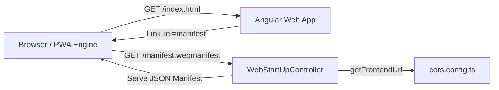

# Requirements

### Overview & Goals
The objective of this task is to lay the foundational architecture for Progressive Web App (PWA) support in Top Nosh. By establishing a dynamic web manifest served from the API and linking it to the client application, we maximize utility for end-users through app installability, standalone display mode, and seamless launch behavior across various devices while maintaining clean, reusable configuration logic across the API.

### Scope
- **In Scope:**
  - Refactoring frontend origin resolution in `apps/api/src/app/cors.config.ts` into an exported helper `getFrontendUrl()` reusable across API modules.
  - Adding a publicly accessible manifest endpoint (`/manifest.webmanifest` and `/manifest.json`) in `WebStartUpController` (`apps/api/src/app/web-start-up-module/web-start-up.controller.ts`).
  - Configuring manifest fields: `name: "Top Nosh"`, `short_name: "Top Nosh"`, `display: "standalone"`, `start_url` dynamically pointing to the frontend URL, and icon definitions referencing icons in `apps/web/public/images/pwa/`.
  - Updating `apps/api/src/main.ts` to exclude the manifest endpoint from the global `/api` prefix.
  - Adding the manifest link tag in `apps/web/src/index.html`.
  - Adding unit test coverage for the refactored origin helper and manifest controller endpoint.
- **Out of Scope:**
  - Service worker registration, offline caching strategies, or push notification handling (reserved for subsequent PWA implementation steps).
  - Modifying or generating new image assets (existing assets in `apps/web/public/images/pwa` will be utilized).

### User Stories
- **As a Top Nosh user**, I want the web app to provide valid PWA metadata so that my browser recognizes it as an installable application with a native standalone window experience.
- **As a system administrator / developer**, I want `start_url` and CORS to derive from a single unified frontend URL resolution strategy so that environment changes work reliably without configuration drift.

### Functional Requirements
1. **Frontend URL Helper**:
   - Provide an exported function `getFrontendUrl(): string` that checks `SERVER_DEVELOPMENT_MODE`, `SERVER_DEVELOPMENT_DOMAIN`, `SERVER_HTTP_DOMAIN`, defaults to `http://localhost:4200`, and strips trailing slashes.
   - `getCorsOptions()` must use `getFrontendUrl()`.
2. **Web Manifest Endpoint**:
   - `WebStartUpController` must expose a `GET` endpoint returning a valid Web App Manifest JSON with `Content-Type: application/manifest+json; charset=utf-8`.
   - Manifest payload must specify:
     - `name`: `"Top Nosh"`
     - `short_name`: `"Top Nosh"`
     - `display`: `"standalone"`
     - `start_url`: `${getFrontendUrl()}/`
     - `icons`: Array of icon objects with `src`, `sizes`, and `type` referencing icons under `/images/pwa/` (Android launcher icons: 48x48, 72x72, 96x96, 144x144, 192x192, 512x512).
3. **Route Exclusion**:
   - The manifest path (`manifest.webmanifest` and `manifest.json`) must be excluded from the global `api` prefix in `apps/api/src/main.ts`.
4. **Client-Side Manifest Link**:
   - `apps/web/src/index.html` must include `<link rel="manifest" href="/manifest.webmanifest" />`.

### Non-Functional Requirements
- **Reliability & Consistency**: Single source of truth for frontend base URL resolution prevents runtime mismatch between CORS policies and PWA launch points.
- **Standards Compliance**: Adherence to W3C Web App Manifest specification ensuring compatibility across Android (Chrome), iOS (Safari), and desktop browsers.

# Technical Design

### Current Implementation
- `apps/api/src/app/cors.config.ts`: Contains origin resolution logic embedded directly within `getCorsOptions()`.
- `apps/api/src/app/web-start-up-module/web-start-up.controller.ts`: Provides `GET /assets/app.properties` returning environment properties. Excluded from `/api` global prefix in `main.ts`.
- `apps/web/src/index.html`: Contains standard metadata, viewport, favicon, and fonts, but lacks a web manifest `<link>` tag.
- `apps/web/public/images/pwa/`: Contains pre-rendered PWA icons across Android (`launchericon-*`), iOS, and Windows directories.

### Key Decisions
1. **Dynamic Manifest Endpoint vs Static File**:
   - *Chosen Approach*: Generate the manifest dynamically in `WebStartUpController`.
   - *Rationale*: Allows `start_url` to accurately reflect the deployed frontend host and port across development, staging, and containerized production environments without requiring rebuilds.
2. **Helper Function Extraction**:
   - *Chosen Approach*: Extract `getFrontendUrl()` in `apps/api/src/app/cors.config.ts` and export it.
   - *Rationale*: Maximizes code reuse and eliminates duplicate environment variable parsing logic across modules.
3. **Endpoint Routing & Prefix Exclusion**:
   - *Chosen Approach*: Map `@Get('manifest.webmanifest')` and `@Get('manifest.json')` in `WebStartUpController`, and exclude both paths from `globalPrefix` in `main.ts`.
   - *Rationale*: Conforms to standard web manifest discovery conventions while preserving existing `/api` scoping for data routes.

### Proposed Changes
- **API (`apps/api`)**:
  - `src/app/cors.config.ts`: Export `getFrontendUrl(): string` and use it inside `getCorsOptions()`.
  - `src/app/web-start-up-module/web-start-up.controller.ts`: Add manifest endpoint returning JSON manifest structure.
  - `src/main.ts`: Add `manifest.webmanifest` and `manifest.json` to `setGlobalPrefix` exclusion array.
  - `src/app/web-start-up-module/web-start-up.controller.spec.ts`: Add test cases validating manifest output structure and dynamic `start_url` resolution.
- **Web (`apps/web`)**:
  - `src/index.html`: Add `<link rel="manifest" href="/manifest.webmanifest" />`.

### Data Models / Contracts

#### Web App Manifest Interface & Payload
```typescript
export interface WebManifestIcon {
  src: string;
  sizes: string;
  type: string;
  purpose?: string;
}

export interface WebManifest {
  name: string;
  short_name: string;
  start_url: string;
  display: 'standalone' | 'fullscreen' | 'minimal-ui' | 'browser';
  icons: WebManifestIcon[];
}
```

#### Generated Manifest JSON Example
```json
{
  "name": "Top Nosh",
  "short_name": "Top Nosh",
  "start_url": "http://localhost:4200/",
  "display": "standalone",
  "icons": [
    {
      "src": "/images/pwa/android/launchericon-48x48.png",
      "sizes": "48x48",
      "type": "image/png"
    },
    {
      "src": "/images/pwa/android/launchericon-72x72.png",
      "sizes": "72x72",
      "type": "image/png"
    },
    {
      "src": "/images/pwa/android/launchericon-96x96.png",
      "sizes": "96x96",
      "type": "image/png"
    },
    {
      "src": "/images/pwa/android/launchericon-144x144.png",
      "sizes": "144x144",
      "type": "image/png"
    },
    {
      "src": "/images/pwa/android/launchericon-192x192.png",
      "sizes": "192x192",
      "type": "image/png"
    },
    {
      "src": "/images/pwa/android/launchericon-512x512.png",
      "sizes": "512x512",
      "type": "image/png"
    }
  ]
}
```

### File Structure
- `apps/api/src/app/cors.config.ts` (Modified: Export `getFrontendUrl`)
- `apps/api/src/app/web-start-up-module/web-start-up.controller.ts` (Modified: Add manifest route handler)
- `apps/api/src/app/web-start-up-module/web-start-up.controller.spec.ts` (Modified: Add manifest unit tests)
- `apps/api/src/main.ts` (Modified: Exclude manifest routes from global prefix)
- `apps/web/src/index.html` (Modified: Add manifest link tag)

### Architecture Diagram


### Risks & Mitigations
- **Risk**: Mismatched MIME type causing browser warning when fetching manifest.
  - *Mitigation*: Explicitly set `@Header('Content-Type', 'application/manifest+json; charset=utf-8')`.
- **Risk**: Missing leading slash or incorrect relative paths for static icons.
  - *Mitigation*: Ensure all icon `src` values match the Angular static assets path `/images/pwa/...`.

# Testing

### Validation Approach
Automated and manual verification ensure maximum system utility, consistency of URL generation, and error-free PWA discovery.

### Key Scenarios
1. **Dynamic Frontend URL Resolution**:
   - Verify `getFrontendUrl()` returns `SERVER_DEVELOPMENT_DOMAIN` when `SERVER_DEVELOPMENT_MODE === 'true'`.
   - Verify `getFrontendUrl()` returns `SERVER_HTTP_DOMAIN` when `SERVER_DEVELOPMENT_MODE` is not `'true'`.
   - Verify default fallback `http://localhost:4200` when environment variables are unset.
   - Verify trailing slashes are consistently stripped.
2. **PWA Manifest Generation**:
   - Verify `GET /manifest.webmanifest` returns HTTP 200 with `application/manifest+json`.
   - Verify `name` and `short_name` are `'Top Nosh'`.
   - Verify `display` is `'standalone'`.
   - Verify `start_url` reflects the resolved frontend URL.
   - Verify `icons` contains valid descriptors for sizes 48x48, 72x72, 96x96, 144x144, 192x192, and 512x512.
3. **HTML Manifest Linkage**:
   - Verify `apps/web/src/index.html` contains `<link rel="manifest" href="/manifest.webmanifest" />`.

### Edge Cases
- `SERVER_DEVELOPMENT_DOMAIN` / `SERVER_HTTP_DOMAIN` containing multiple trailing slashes (e.g. `http://localhost:4200///`).
- Environment variable set to empty whitespace string.
- Direct root request vs `/api` prefixed request.

### Test Changes
- Add unit tests in `apps/api/src/app/web-start-up-module/web-start-up.controller.spec.ts` covering manifest generation under varied environment variable configurations.
- Run Jest test suite `npx jest apps/api/src/app/web-start-up-module/web-start-up.controller.spec.ts` and `npx jest apps/api/src/app/cors.e2e.spec.ts`.

# Delivery Steps

### ✓ Step 1: Refactor frontend URL resolution logic in API
Extract and standardize the frontend URL resolution logic into a reusable helper function to ensure consistent origin resolution across CORS and PWA manifest generation.

- Refactor `apps/api/src/app/cors.config.ts` to export a standalone helper function `getFrontendUrl()` that determines the frontend base URL based on `SERVER_DEVELOPMENT_MODE`, `SERVER_DEVELOPMENT_DOMAIN`, and `SERVER_HTTP_DOMAIN` (falling back to `http://localhost:4200` with trailing slashes stripped).
- Update `getCorsOptions()` in `apps/api/src/app/cors.config.ts` to consume `getFrontendUrl()`.
- Create/update unit tests for `getFrontendUrl()` covering default fallbacks, development mode overrides, and trailing slash normalization.

### ✓ Step 2: Implement PWA manifest endpoint in WebStartUpController and configure route exclusion
Implement the public PWA manifest endpoint in NestJS to serve standard web application metadata and icon mappings.

- Add `@Get('manifest.webmanifest')` and `@Get('manifest.json')` handlers to `WebStartUpController` in `apps/api/src/app/web-start-up-module/web-start-up.controller.ts`.
- Construct the manifest payload with `name: 'Top Nosh'`, `short_name: 'Top Nosh'`, `display: 'standalone'`, `start_url` computed via `getFrontendUrl()`, and the icon manifest array mapping available assets from `images/pwa/android` (e.g., 48x48, 72x72, 96x96, 144x144, 192x192, 512x512) and iOS/Windows where applicable.
- Update global prefix route exclusion list in `apps/api/src/main.ts` so manifest routes are accessible directly from root paths.
- Add comprehensive unit tests in `apps/api/src/app/web-start-up-module/web-start-up.controller.spec.ts` verifying manifest fields, content type headers, and dynamic `start_url` computation.

### ✓ Step 3: Link PWA manifest in web application index HTML
Connect the frontend application to the newly provided manifest endpoint to enable progressive web application discovery and installation.

- Update `apps/web/src/index.html` to declare `<link rel="manifest" href="/manifest.webmanifest" />` inside the `<head>` tag.
- Verify end-to-end compatibility of manifest delivery and asset references across client and server.