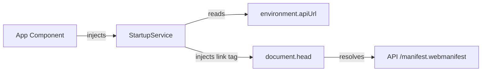

# Requirements

### Overview & Goals
The objective of this task is to maximize the utility and deployment flexibility of the Top Nosh Progressive Web App (PWA) across diverse deployment environments. Because the backend API dynamically generates the web manifest and the frontend's API host is determined at runtime via dynamic configuration, the manifest link must be injected dynamically into the document head rather than statically hardcoded in `index.html`.

### Scope
- **In Scope**:
  - Remove hard-coded `<link rel="manifest" href="/manifest.webmanifest"/>` from `apps/web/src/index.html`.
  - Implement `StartupService` in `apps/web/src/system/services/startup/startup.service.ts` to construct the absolute manifest URL using `environment().apiUrl` and append the `<link rel="manifest">` tag into `document.head`.
  - Inject `StartupService` in `apps/web/src/app/app.ts` constructor so dynamic injection executes immediately during application initialization.
  - Implement full unit test coverage for `StartupService` and update `App` component tests.
- **Out of Scope**:
  - Modifications to the backend manifest generation controller (`apps/api/src/app/web-start-up-module/web-start-up.controller.ts`).
  - Service worker caching or push notification handling.

### User Stories
- As an operator deploying Top Nosh across multiple server environments, I want the web application to dynamically link to the backend manifest endpoint at runtime so that the PWA manifest resolves accurately without rebuilding frontend assets.
- As an end user, I want the browser to detect the PWA manifest automatically upon application startup so that the app is recognized as installable on desktop and mobile platforms.

### Functional Requirements
- `apps/web/src/index.html`: Must no longer contain `<link rel="manifest" href="/manifest.webmanifest"/>`.
- `StartupService` (`apps/web/src/system/services/startup/startup.service.ts`):
  - Must be provided in root (`providedIn: 'root'`).
  - Must inject `DOCUMENT` from `@angular/common` to interact with the DOM head.
  - Must retrieve `apiUrl` via `environment().apiUrl` and format the URL by trimming any trailing slashes (`.replace(/\/+$/, '')`).
  - Must construct `<link rel="manifest" href="<apiUrl>/manifest.webmanifest">` and append it to `document.head`.
- `App` component (`apps/web/src/app/app.ts`):
  - Must inject `StartupService` inside `constructor()` to ensure eager execution on bootstrap.

### Non-Functional Requirements
- **Efficiency & Utility**: Dynamic injection must happen synchronously upon startup with zero visual stutter or layout shift.
- **Maintainability & Robustness**: Standard Angular dependency injection (`DOCUMENT`) must be used rather than global browser primitives to guarantee clean testability.

# Technical Design

### Current Implementation
- `apps/web/src/index.html`: Line 9 contains a static `<link rel="manifest" href="/manifest.webmanifest"/>`.
- `apps/web/src/environments/environment.ts`: Exposes `environment()` returning dynamic properties including `apiUrl: getEnv('API_URL').string()`.
- `apps/web/src/system/interceptors/base-url/base-url.interceptor.ts`: Demonstrates standard URL sanitization: `const baseUrl = environment().apiUrl.replace(/\/+$/, '')`.
- `apps/api/src/main.ts` & `apps/api/src/app/web-start-up-module/web-start-up.controller.ts`: The backend serves the manifest at route `/manifest.webmanifest` (bypassing `/api` global prefix).
- `apps/web/src/app/app.ts`: Eagerly injects application-wide startup services (e.g. `ThemeManagerService`) inside its constructor.

### Key Decisions
- **Inject via Angular DOCUMENT token**: Using `@Injectable` and Angular's `DOCUMENT` token ensures decoupled DOM manipulation that can be mocked cleanly in tests and remains SSR-safe.
- **Initialization via App constructor**: Calling `inject(StartupService)` in the `App` component constructor guarantees immediate injection during bootstrap while following existing architectural conventions (consistent with `ThemeManagerService`).
- **Endpoint URL structure**: Constructing `${baseUrl}/manifest.webmanifest` ensures exact alignment with the NestJS backend route definition.

### Proposed Changes
- **`apps/web/src/system/services/startup/startup.service.ts`**:
  - Create `StartupService` with root injection.
  - On instantiation, compute the absolute URL using `environment().apiUrl` and create/append `<link rel="manifest" href="...">` to `document.head`.
- **`apps/web/src/app/app.ts`**:
  - Add `inject(StartupService)` inside `App.constructor`.
- **`apps/web/src/index.html`**:
  - Remove line 9 `<link rel="manifest" href="/manifest.webmanifest"/>`.

### File Structure
- Added files:
  - `apps/web/src/system/services/startup/startup.service.ts`
  - `apps/web/src/system/services/startup/startup.service.spec.ts`
- Modified files:
  - `apps/web/src/app/app.ts`
  - `apps/web/src/app/app.spec.ts`
  - `apps/web/src/index.html`

### Architecture Diagram

### Risks & Mitigations
- **Duplicate Link Tags**: Because `StartupService` is a singleton (`providedIn: 'root'`) and invoked in `App` root component, it executes once per application lifecycle.
- **Trailing Slash Variances in API URL**: Handled via `.replace(/\/+$/, '')` sanitization to prevent malformed URLs (`//manifest.webmanifest`).

# Testing

### Validation Approach
Automated unit testing using Jest via Nx (`npx nx test web`) will verify that the manifest element is correctly structured and appended during startup, and that application startup runs without regressions.

### Key Scenarios
- **Dynamic Link Element Creation**:
  - Verify that `StartupService` creates an HTML `<link>` element with `rel="manifest"`.
  - Verify that the link's `href` attribute is set to `<apiUrl>/manifest.webmanifest`.
  - Verify that the link element is appended to `document.head`.
- **URL Normalization**:
  - When `apiUrl` is configured with a trailing slash (e.g. `http://localhost:3000/`), verify `href` resolves cleanly to `http://localhost:3000/manifest.webmanifest`.
  - When `apiUrl` has no trailing slash (e.g. `http://localhost:3000`), verify `href` resolves cleanly to `http://localhost:3000/manifest.webmanifest`.
- **App Root Integration**:
  - Verify `App` component instantiates and initializes `StartupService` successfully during component creation.
- **HTML Cleanup**:
  - Verify `apps/web/src/index.html` no longer contains the hardcoded manifest link tag.

### Test Changes
- **Add** `apps/web/src/system/services/startup/startup.service.spec.ts`: Unit test suite testing DOM injection and URL normalization.
- **Update** `apps/web/src/app/app.spec.ts`: Ensure `App` tests pass with the new service dependency.

# Delivery Steps

### ✓ Step 1: Implement StartupService for dynamic manifest injection with unit tests
`StartupService` is created in `apps/web/src/system/services/startup/` to dynamically construct and inject the manifest `<link>` tag into the document head, accompanied by comprehensive unit tests.

- Create `apps/web/src/system/services/startup/startup.service.ts` annotated with `@Injectable({ providedIn: 'root' })`.
- Inject Angular's `DOCUMENT` token to safely manipulate the DOM `<head>` element.
- Retrieve the API base URL via `environment().apiUrl`, strip trailing slashes, and construct the absolute manifest URL (`${baseUrl}/manifest.webmanifest`).
- Create and append a `<link rel="manifest" href="...">` element to `document.head` during service initialization.
- Create unit tests in `apps/web/src/system/services/startup/startup.service.spec.ts` testing URL resolution, trailing slash handling, and DOM element injection using a mocked `DOCUMENT` and `environment`.

### ✓ Step 2: Remove static manifest link from index.html and initialize StartupService in App
The static manifest reference is removed from `index.html`, `StartupService` is eagerly instantiated in `App`, and application test suites are updated.

- Remove `<link rel="manifest" href="/manifest.webmanifest"/>` from `apps/web/src/index.html`.
- Inject `StartupService` inside the constructor of `App` in `apps/web/src/app/app.ts` alongside existing service initializers.
- Verify and update `apps/web/src/app/app.spec.ts` to ensure `App` test suite runs cleanly with `StartupService`.
- Run the full web test suite (`npx nx test web`) to validate that all tests pass without regressions.